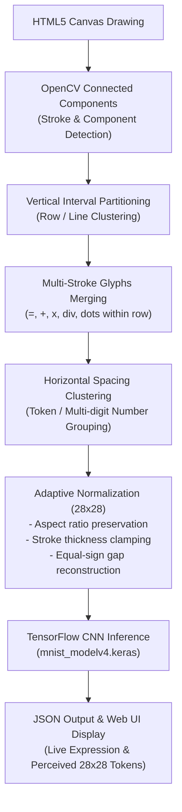

# Handwritten Digits & Mathematical Expressions Predictor

An end-to-end deep learning and computer vision web application that recognizes multi-digit numbers, arithmetic operators, decimal numbers, and algebraic expressions drawn on an interactive HTML5 canvas in real time.

Built with **FastAPI**, **TensorFlow / Keras (CNN)**, **OpenCV**, and vanilla JavaScript/CSS.

---

## Key Features

- **19-Class Recognition Vocabulary**:
  - **Digits**: `0`, `1`, `2`, `3`, `4`, `5`, `6`, `7`, `8`, `9`
  - **Arithmetic Operators**: `+`, `-`, `*`, `/`, `=`
  - **Punctuation & Variables**: `.`, `x`, `y`, `z`
- **Multi-Stroke Symbol Merging**:
  - Automatically merges multi-stroke glyphs within each line, including double-bar symbols (`=`), stacked division symbols (`÷`), intersecting strokes (`+`, `x`), and decimal points/dots.
- **Hierarchical Layout Segmentation**:
  - **Row Grouping**: Partitions drawn content into horizontal lines based on bounding interval vertical overlap.
  - **Token Clustering**: Groups closely spaced characters into multi-digit numbers while preserving whitespace gaps between operators and operands.
- **Adaptive Stroke Normalization**:
  - **Aspect-Ratio Aware Scaling**: Preserves character geometry without non-uniform stretching.
  - **Minus-Sign Thickness Clamping**: Prevents canvas brush strokes from scaling into thick blocks that could trigger false positive `=` predictions.
  - **Equals-Sign Gap Preservation**: Prevents anti-aliasing sinc filters from blurring the gap between parallel bars into a `z`.
- **Live Receptive Field Inspection**:
  - Shows real-time $28 \times 28$ normalized tensors alongside their individual confidence bars so you can see exactly what the CNN perceives.

---

## System Architecture & Pipeline



---

## Model Architecture

The core classifier (`mnist_modelv4.keras`) is a Convolutional Neural Network trained on MNIST and handwritten mathematical symbols:

- **Input Dimension**: $(28, 28, 1)$ grayscale images.
- **Internal Rescaling**: Normalizes pixel values from $[0, 255]$ to $[0.0, 1.0]$ with polarity inversion.
- **Convolutional Backbone**:
  - `Conv2D(32, (3, 3), activation='relu')` + `MaxPooling2D((2, 2))`
  - `Conv2D(64, (3, 3), activation='relu')` + `MaxPooling2D((2, 2))`
  - `Conv2D(64, (3, 3), activation='relu')`
- **Dense Classifier**:
  - `Flatten()`
  - `Dense(128, activation='relu')` + `Dropout(0.3)`
  - `Dense(19, activation='softmax')` (Output logits for 19 classes)

---

## Getting Started

### 1. Prerequisites
- Python 3.10+ (tested with Python 3.12)
- Virtual environment (`venv`)

### 2. Installation

Clone the repository and install required dependencies:

```bash
# Navigate to project directory
cd drawing_digits_predictor

# Activate virtual environment
source .venv/bin/activate

# Install dependencies
pip install fastapi uvicorn tensorflow opencv-python pillow numpy
```

### 3. Run the Development Server

Start the FastAPI application with live-reload:

```bash
uvicorn app:app --reload
```

The application will be accessible at:
- **Web UI**: [http://localhost:8000](http://localhost:8000)
- **Interactive Swagger Docs**: [http://localhost:8000/docs](http://localhost:8000/docs)
- **Health Check**: [http://localhost:8000/health](http://localhost:8000/health)

